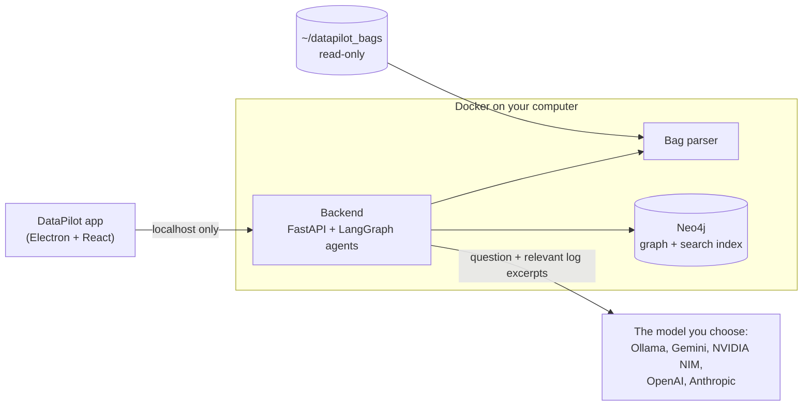

<p align="center">
  
</p>

<h1 align="center">DataPilot</h1>

<p align="center">
  <strong>Ask your robot's logs why it failed.</strong><br>
  A free, open-source desktop copilot that reads ROS 2 bags, finds the root cause,<br>
  and shows you the log lines that prove it. Your data stays on your machine.
</p>

<p align="center">
  <a href="https://github.com/bringup-labs/datapilot/releases/latest"></a>
</p>

<p align="center">
  <a href="https://github.com/bringup-labs/datapilot/releases/latest"></a>
  <a href="https://github.com/bringup-labs/datapilot/actions/workflows/ci.yml"></a>
  <a href="LICENSE"></a>
</p>

When a robot misbehaves, the evidence is buried in a bag file: thousands of log lines, diagnostics and sensor topics from dozens of nodes. DataPilot indexes the bag on your computer and lets you ask about it in plain language. Specialist AI agents trace the failure through the data and answer with the chain of events, timestamps, and the exact lines they relied on.

## Quick start

About 10 minutes from download to your first answer.

1. **Install Docker and start it.** On macOS, install [Docker Desktop](https://www.docker.com/products/docker-desktop/). On Linux, install [Docker Engine](https://docs.docker.com/engine/install/) and [add yourself to the `docker` group](https://docs.docker.com/engine/install/linux-postinstall/).
2. **[Download DataPilot](https://github.com/bringup-labs/datapilot/releases/latest)**: the `.dmg` for macOS (Apple silicon and Intel) or the `.AppImage` for Linux (x64). On Linux, make it executable with `chmod +x DataPilot-*.AppImage`.
3. **Open DataPilot.** The first launch downloads its local services, about 1.5 GB, which takes a minute or two on a fast connection. This happens once.
4. **Connect an AI model.** Open **Settings** (the gear at the bottom left), then **Models & API Keys**. The quickest free option is a Gemini key: create one at [Google AI Studio](https://aistudio.google.com/apikey) and paste it into **Gemini (Google)**. To keep everything on your computer, use Ollama instead. All the options are in [Free to use](#free-to-use).
5. **Load the sample bag and ask a question.** Download the sample recording into DataPilot's bag folder:

   ```bash
   mkdir -p ~/datapilot_bags && curl -L -o ~/datapilot_bags/warehouse_nav_abort.mcap https://raw.githubusercontent.com/bringup-labs/datapilot/main/sample_bags/warehouse_nav_abort.mcap
   ```

   Click **Load ROS bag**, choose `warehouse_nav_abort.mcap`, and ask *Why did navigation abort?*

> [!TIP]
> Put your own bags in `~/datapilot_bags` too, either `.mcap` files or `.db3` bags. DataPilot's services can only read that folder, which keeps the rest of your files out of their reach. If you pick a bag somewhere else, DataPilot tells you and offers to open the folder.

## Free to use

DataPilot is free and open source under the Apache 2.0 license. There is no account, no sign-up, no usage limit and no telemetry. All you need is an AI model, and three of the supported options cost nothing:

| Model | Cost | Where your log excerpts go | Set it up in Settings → Models & API Keys |
|---|---|---|---|
| **[Ollama](https://ollama.com)**, local | Free | Nowhere. Everything stays on your computer. | Install Ollama and run `ollama pull llama3.2`. In **Ollama (local)**, click **Set default**, then **Refresh models**. |
| **[Gemini](https://aistudio.google.com/apikey)** | Free tier | Google. On the free tier, Google may use the content to improve its products. | Paste the key into **Gemini (Google)**. Gemini is already the default. |
| **[NVIDIA NIM](https://build.nvidia.com)** | Free for development and testing, through the [NVIDIA Developer Program](https://developer.nvidia.com/nim) | NVIDIA | Paste the key into **NVIDIA NIM**, then click **Set default** and **Refresh models**. |
| OpenAI, Anthropic, or any OpenAI-compatible endpoint | Billed by the provider | That provider | Paste the key and click **Set default**. |

A small local model like `llama3.2` runs on most laptops but gives shallower answers than a hosted model. On the **Agents & MCP** screen you can also give each specialist agent its own model.

Docker Desktop is free for personal use, education, non-commercial open source, and companies with fewer than 250 employees and less than $10 million in annual revenue. Larger organizations need a [paid Docker subscription](https://docs.docker.com/subscription-billing/desktop-license/). Docker Engine on Linux is free for everyone.

## Your data stays on your machine

- Parsing, indexing and the knowledge graph all run in Docker containers on your computer.
- Those containers can read only `~/datapilot_bags`, and only read-only.
- When you ask a question, DataPilot sends the question and the relevant log excerpts to the model you chose, and nothing else. With Ollama, nothing leaves your computer.
- API keys are encrypted with your operating system's keychain and are never sent through the app's web interface.
- No analytics or telemetry. The only other network traffic is downloading DataPilot's services on first launch, and a 90 MB embedding model from Hugging Face the first time you load a bag.

## What it does

- **Answers questions in plain language.** A supervisor agent plans the investigation and runs the right specialists: Root Cause Analyst, Anomaly Detector, Performance Profiler, Replay Narrator, Safety Auditor and Release Comparator. You watch each step as it runs.
- **Shows its evidence.** Findings that report a fault must cite log lines from your bag, and any whose citations don't check out are dropped.
- **Timeline** of every warning and failure in the run, with failures in their own lane so you can zoom straight to them.
- **Logs** with full-text search and severity filters.
- **Topics** with message counts and rates, so a sensor that went quiet stands out.
- **Knowledge graph** connecting sensors, topics, nodes and faults, including cause-and-effect links from a built-in rule set.
- **Bring your own model**: Ollama, Gemini, NVIDIA NIM, OpenAI, Anthropic, or any OpenAI-compatible endpoint.
- Reads ROS 2 bags in **MCAP** (`.mcap`) and **SQLite** (`.db3`) format.

## Requirements

| | |
|---|---|
| Operating system | macOS on Apple silicon or Intel, in a version [Docker Desktop supports](https://docs.docker.com/desktop/setup/install/mac-install/#system-requirements), or Linux on x64 |
| Docker | Docker Desktop on macOS, Docker Engine 20.10 or later on Linux |
| Memory | 8 GB. DataPilot's services use about 2 GB while analyzing a bag. |
| Disk | About 5 GB free for the app and its services, plus your bags |
| Network | Needed on first launch, the first time you load a bag, and for hosted models. Not needed with Ollama after that. |

## Troubleshooting

| You see | What to do |
|---|---|
| **Docker daemon offline** | Start Docker Desktop, wait until it says it is running, then click **Retry connection**. |
| **Docker socket permission denied** (Linux) | Run `sudo usermod -aG docker $USER`, then log out and back in. |
| **Network port conflict** | Another program is using port 7474, 7687 or 8000. Run `lsof -i :7474 -i :7687 -i :8000` to find it, stop it, then retry. |
| **Registry ingestion failure** | DataPilot couldn't download its services. Check your internet connection, proxy and free disk space, then retry. |
| Docker Desktop shows **unable to start** | Your disk is probably full. Free up space and restart Docker Desktop. |
| **This bag is outside DataPilot's bag folder** | Move or copy the bag into `~/datapilot_bags` and load it again. |
| **AI Model Not Connected** | Add a key or set up Ollama in **Settings → Models & API Keys**. |
| Ollama's model list is empty | Make sure Ollama is running and you have pulled a model (`ollama pull llama3.2`), then click **Refresh models**. On Linux, set `OLLAMA_HOST=0.0.0.0:11434` for the Ollama service so DataPilot's containers can reach it. |

Still stuck? [Open an issue](https://github.com/bringup-labs/datapilot/issues/new) and include what you see on the setup screen.

## Status and limitations

DataPilot is in beta. What isn't there yet:

- Windows support. DataPilot runs on macOS and Linux.
- ROS 1 `.bag` files. Convert them to MCAP or `.db3` first, for example with [`rosbags-convert`](https://ternaris.gitlab.io/rosbags/topics/convert.html).
- Opening bags by drag and drop. Use **Load ROS bag** instead.
- The Map and Metrics tabs are early previews, and connecting to a live robot isn't available yet.
- Very large bags, tens of gigabytes, haven't been benchmarked yet.
- The cause-and-effect rule set is small and focused on navigation failures.

## How it works



When you load a bag, the parser extracts topics, logs, diagnostics and transforms. The backend embeds the log lines for semantic search, applies cause-and-effect rules, and stores everything in a local Neo4j graph. When you ask a question, a supervisor agent picks specialist agents, which query that graph and the raw bag through their tools, and a composer agent writes the answer from their cited findings. See [docs/ARCHITECTURE.md](docs/ARCHITECTURE.md) for more.

## Uninstall

1. Quit DataPilot, which also stops its containers, and delete the app.
2. Remove its Docker images:

   ```bash
   docker rmi $(docker images -q 'ghcr.io/bringup-labs/datapilot-*')
   ```

3. Remove its data: `~/Library/Application Support/DataPilot` on macOS or `~/.config/DataPilot` on Linux. The knowledge graph lives in the Docker volumes `neo4j-data` and `neo4j-logs`. Delete them with `docker volume rm neo4j-data neo4j-logs`, but only if no other project uses volumes with those names. Your bags in `~/datapilot_bags` are never deleted.

## Build from source

You need Node.js 22 or later, [pnpm](https://pnpm.io/installation) and Docker.

```bash
git clone https://github.com/bringup-labs/datapilot.git
cd datapilot
pnpm install
docker compose build
pnpm dev
```

`docker compose build` builds the local services from this checkout. It takes a few minutes the first time. `pnpm dev` then starts the app in development mode. It uses a separate settings profile, so it won't touch an installed copy of DataPilot.

| Command | What it does |
|---|---|
| `pnpm test` | Runs the app's unit tests |
| `pnpm typecheck` and `pnpm lint` | Type-checks and lints the app |
| `pnpm test:backend` | Runs the backend tests. Needs [uv](https://docs.astral.sh/uv/). |
| `pnpm package:mac`, `pnpm package:linux` | Builds the installers |

The sample bag is generated by [`sample_bags/generate_sample_bag.py`](sample_bags/generate_sample_bag.py).

## Contributing

Bug reports, ideas and pull requests are welcome. Please [open an issue](https://github.com/bringup-labs/datapilot/issues) first for larger changes, so we can agree on the approach. [AGENT.md](AGENT.md) describes the codebase conventions.

## License

[Apache 2.0](LICENSE)
